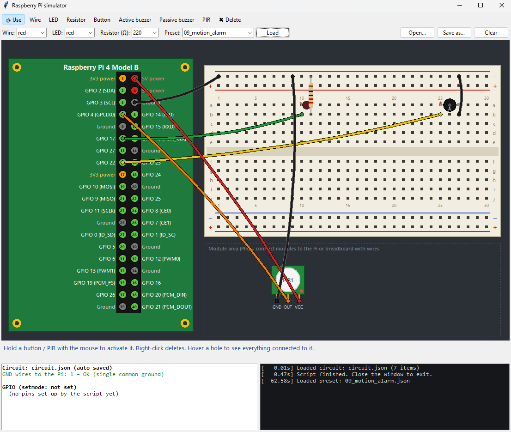

# rpi-sim – Raspberry Pi GPIO simulator

[](https://github.com/aleksandar-aleksandar/rpi-sim/actions/workflows/tests.yml)

Write Raspberry Pi GPIO code on your PC, wire up a virtual breadboard, and watch
it behave like the real thing. No Pi required.

rpi-sim is a drop-in replacement for the `RPi.GPIO` library, and it also
supports the most common parts of `gpiozero`. Your script stays exactly the
same as on a real Raspberry Pi (`import RPi.GPIO as GPIO` or
`from gpiozero import LED`). Instead of real hardware, a window opens with a
40-pin Pi header, a breadboard, and components you place and wire yourself.

rpi-sim doesn't just show pin states: it **solves the circuit you built**. An LED
only lights if current can actually flow from the GPIO pin through the LED to
ground. Wiring mistakes behave like they would in real life, and the simulator
tells you why.



## Features

- **Real wiring**: a 40-pin header with correct labels, a 30-column breadboard
  with power rails, and wires you draw between pins, holes, and module terminals.
- **Components**:
  - LED (5 colors) and RGB LED (common cathode)
  - resistors (220 Ω, 1 kΩ, 10 kΩ) and push button
  - active buzzer and passive buzzer
  - PIR motion sensor, SG90 servo, and HC-SR04 ultrasonic distance sensor
- **An electrical model that catches real mistakes**:
  - LED without a resistor → "burning out"
  - LED or buzzer inserted backwards → stays dark or silent
  - both legs in the same breadboard column → shorted
  - a GPIO output tied to GND, or 3V3 tied to GND → short circuit
  - 5V wired to a GPIO pin → warning that this would damage a real Pi
  - an input with no pull-up/down and nothing connected → floating, reads random values
  - a PIR or servo without a 5V supply → doesn't work
  - a servo driven at the wrong PWM frequency or pulse width → warning
- **Timing you can measure**: the ultrasonic sensor answers the classic
  busy-wait `TRIG`/`ECHO` measurement to within about a centimetre.
- **Sound**: a passive buzzer plays the actual PWM frequency, an active buzzer
  beeps on HIGH. Sound works on Windows only.
- **PWM**: LED brightness and RGB color follow the duty cycle, and the servo
  horn follows the pulse width.
- **A comfortable editor**:
  - drag parts to move them
  - undo/redo
  - keys 1–9 hold buttons and PIR sensors
  - mouse wheel sets the distance the ultrasonic sensor sees
  - hover any hole or pin to see everything electrically connected to it
- **Ground check**: shows how many wires go to the Pi's GND pins. One common
  ground plus a GND rail is the clean way to wire a board.
- **Presets**: ready-made circuits for every example, loadable from the toolbar.
  Running an example never modifies its preset.
- **Matches the real API**: `setmode`, `setup`, `output`, `input`, `PWM`,
  `add_event_detect` with `bouncetime`, `add_event_callback`, `event_detected`,
  `wait_for_edge`, `remove_event_detect`, `cleanup`, `BCM` and `BOARD`
  numbering. Mistakes raise the same errors as the real library (e.g.
  *"Please set pin numbering mode…"*).

## Quick start

Requirements: **Python 3.10+** with tkinter (included in the standard Windows and
macOS installers). There are no other dependencies.

```bash
git clone https://github.com/aleksandar-aleksandar/rpi-sim.git
cd rpi-sim

python main.py examples/01_blink.py      # run an example with its preset circuit
python main.py                           # open an empty editor (circuit.json)
python main.py my_script.py              # run your own script (circuit: my_script.json)
python main.py -c board.json my_script.py
```

Stop a running script with **Ctrl+C** in the terminal. The window stays open so
you can inspect the final state. Close it to exit.

### Installing with pip

```bash
pip install .                            # from the cloned folder
rpi-sim examples/08_reaction_game.py     # the rpi-sim command works anywhere
```

This installs the `rpi-sim` command along with the simulated `RPi` and
`gpiozero` packages. The examples and presets stay in the cloned repository.

> ⚠️ **Don't install rpi-sim on a real Raspberry Pi** or into an environment
> that has the real `RPi.GPIO` or `gpiozero`. The simulator would shadow them.
> Use a virtual environment on your PC.

> **Without the launcher:** copy the `RPi/` folder (and `gpiozero/` if you use
> it) next to your script and run it normally. The circuit is then saved to
> `circuit.json` next to the script.

## Using the editor

| Tool | How |
|---|---|
| **Use** | Hold a button or PIR (or press its number key 1–9). Drag any part to move it. Scroll over an ultrasonic sensor to change the distance (Shift = 1 cm steps). |
| **Wire** | Click two points: Pi pins, breadboard holes, or module terminals. |
| **LED** | First click is the anode (+), second the cathode (−). |
| **RGB LED** | One click places all four legs: R, K (cathode), G, B. |
| **Resistor / Button / Buzzers** | Two clicks, one per leg. For buzzers, + comes first. |
| **PIR / Servo / Ultrasonic** | Click in the grey module area below the breadboard, then wire up the terminals. |
| **Delete** | Click an item, or right-click it in any mode. |

| Key | Action |
|---|---|
| **1–9** | hold the Nth button / PIR (the number is shown on the part) |
| **Ctrl+Z / Ctrl+Y** | undo / redo (Ctrl+Shift+Z also redoes) |
| **Esc** | cancel a placement in progress |

- Each hole, pin, or terminal holds one item, just like the real hardware.
- The circuit is auto-saved after every change. When you run an example, the
  preset is copied to `~/.rpi-sim/examples/`, so your edits go there and the
  preset stays clean. Use `-c` to choose a file yourself.
- The bottom panels show each pin's state, warnings, and a timestamped log of
  everything your script does.

## Examples

| # | Example | Shows |
|---|---|---|
| 01 | `blink` | digital output, `time.sleep` |
| 02 | `button_led` | input with internal pull-up, polling |
| 03 | `button_callback` | `add_event_detect`, `FALLING`, `bouncetime` |
| 04 | `pwm_fade` | PWM duty cycle → LED brightness |
| 05 | `active_buzzer` | active buzzer = plain HIGH/LOW |
| 06 | `passive_buzzer` | passive buzzer = PWM frequency is the pitch |
| 07 | `pir_motion` | PIR sensor (5V supply, digital output), `BOTH` edges |
| 08 | `reaction_game` | LED + button + passive buzzer, random delay, timeout |
| 09 | `motion_alarm` | LED + PIR + active buzzer |
| 10 | `common_mistakes` | a broken circuit: fix it until the warnings disappear |
| 11 | `rgb_led` | three PWM channels mixing a rainbow |
| 12 | `servo` | 50 Hz PWM, pulse width → angle |
| 13 | `ultrasonic` | TRIG pulse + timing the ECHO pulse |
| 14 | `gpiozero_button_led` | the same button + LED in gpiozero style |
| 15 | `parking_sensor` | gpiozero: distance → RGB color + beeping |

Every example has a matching `.json` preset with the circuit already wired.
`tools/build_presets.py` regenerates the presets.

## gpiozero support

```python
from gpiozero import LED, Button, pause

led = LED(17)
button = Button(27)
button.when_pressed = led.on
button.when_released = led.off
pause()
```

Supported classes:
- outputs: `LED`, `PWMLED`, `RGBLED`, `Buzzer`, `TonalBuzzer` (with
  `gpiozero.tones.Tone`), `OutputDevice`, `PWMOutputDevice`
- inputs: `Button` (press, release, and hold callbacks), `MotionSensor`,
  `InputDevice`
- motors and sensors: `Servo`, `AngularServo`, `DistanceSensor`
- `pause()`

Pins are BCM numbers (`17`) or strings (`"GPIO17"`, `"BOARD11"`). Everything
runs through the simulated `RPi.GPIO`, so wiring mistakes show up here too.

## How it works

```
your_script.py ── import RPi.GPIO ──► RPi/GPIO.py   (same API as the real library)
       │                                  │
       └── from gpiozero ... ──► gpiozero/ ┘   (built on top of RPi.GPIO)
                                          ▼
                                     RPi/_core.py   circuit + electrical model
                                          ▲
                                          │
                                     RPi/_ui.py     tkinter window (separate thread)
```

The core groups connected points into **nets**. A net is a breadboard column
strip, a rail, everything joined by wires, a pressed button, or the Pi's
internally connected GND / 3V3 / 5V pins. Each net is driven by sources: 3V3,
5V, GND, GPIO outputs, or module outputs (PIR, ultrasonic ECHO).

Resistors join nets without shorting them. An LED lights when its anode
resolves to a higher voltage than its cathode and there is a resistor
somewhere in the loop. Input pins read their net's voltage, fall back to the
internal pull-up or pull-down, or float.

Edge callbacks run sequentially on a background thread, like in `RPi.GPIO`.
The ultrasonic ECHO pin is read from high-resolution timestamps, so a
busy-wait measurement sees the pulse at the exact moment it starts and ends.

## Tests

```bash
python -m unittest discover -s tests -v
```

The tests are standard-library only and run headless (`RPISIM_HEADLESS=1`).
The editor tests need a display and skip automatically without one. CI runs
everything on Linux (under xvfb) and Windows, for Python 3.10–3.14.

## Limitations

- The button has 2 legs. A real tactile switch has 4, internally connected in
  pairs.
- Power rails run the full length of the board. On some real breadboards the
  rails are split in the middle.
- The model is a simplified DC model. It doesn't calculate currents, so LED
  brightness only comes from PWM, not from the resistor value.
- The ultrasonic sensor's ECHO is modelled as 3.3V logic, like the HC-SR04P. A
  classic 5V HC-SR04 needs a voltage divider on ECHO on a real Pi.
- On Windows, `time.time()` only ticks about once per millisecond (≈17 cm for
  the ultrasonic sensor). Use `time.perf_counter()` for timing. It works the
  same way on a real Pi.
- Sound only works on Windows (`winsound`). On other platforms the buzzers are
  visual only.

## Roadmap ideas

- 4-leg tactile button, potentiometer with an ADC (MCP3008, SPI)
- DHT11 temperature/humidity sensor, LCD 16×2 over I²C
- Cross-platform sound
- Publishing to PyPI

## License

MIT, see [LICENSE](LICENSE).
